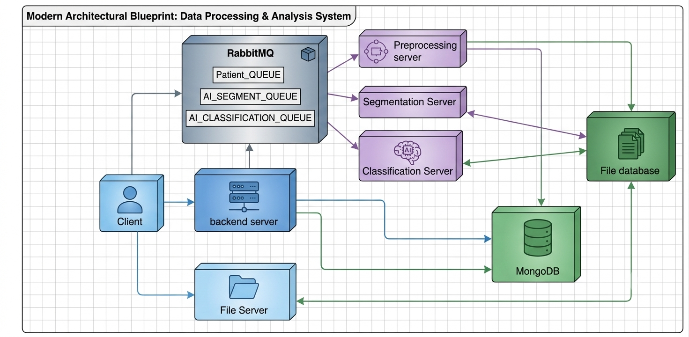

# 🧠 Web-Based CAD System - Brain Tumor Diagnosis


Final Graduation Thesis project for the **Computer Science / Information Technology** degree at **HUFLIT**. This system simulates an end-to-end clinical decision support system (**Web-based CAD**) designed for automatic **brain tumor sub-region segmentation** and **multi-class classification** from multi-parametric Magnetic Resonance Imaging (mpMRI).

## 📖 Table of Contents
- [System Architecture](#-system-architecture)
- [Tech Stack](#-tech-stack)
- [Key Features](#-key-features)
- [Performance Metrics](#-performance-metrics)
- [Installation & Deployment](#-installation--deployment)
- [Folder Path Summary](#-folder-path-summary)
- [Authors & Academic Credits](#-authors--academic-credits)

---

## 🏗️ System Architecture

The core of this system relies on a microservices-based distributed model to decouple computationally heavy deep learning models from web events, preventing UI freeze and ensuring high clinical throughput.

> **Note:** Replace the image path below with your actual architecture diagram uploaded to GitHub.


*Figure 1: High-level Microservices Architecture illustrating the React Frontend, Node.js API Gateway, RabbitMQ Broker, and Python AI Workers.*

### Data Flow Overview:
1. **Client (Web App):** Built with **React.js** and **Vite**, offering intuitive drag-and-drop `.nii` DICOM/NIfTI file uploading and real-time visualization of diagnostic results.
2. **API Gateway (Backend):** Built with **Node.js/Express**, handles CORS, multi-part form requests, patient metadata management, and encrypts payload tokens.
3. **RabbitMQ Broker:** Implements asynchronous queues (`Patient_QUEUE`, `AI_SEGMENT_QUEUE`, `AI_CLASSIFICATION_QUEUE`) to queue incoming heavy MRI processing tasks.
4. **AI Microservices (Workers):** Independent Python processes that listen to queues:
   - **Worker 1 (Preprocessing):** Applies Z-score intensity normalization and spatial resampling.
   - **Worker 2 (Segmentation):** Executes the **UNETR** model to extract 3D sub-regions: Whole Tumor ($WT$), Tumor Core ($TC$), and Enhancing Tumor ($ET$).
   - **Worker 3 (Classification):** Combines **ConvNeXt-Tiny** and **EfficientNetV2-B0** with Cross-Attention Fusion to classify tumor types (*Glioma, Meningioma, Pituitary*).
5. **MongoDB Cluster:** Persists structured records including patient clinical history, ROI metadata, model logs, and confidence scores.

---

## 💻 Tech Stack

- **Frontend (Client):** React.js (v18), Vite, Axios, Custom CSS3 / Tailwind.
- **Backend & Gateway:** Node.js, Express.js.
- **AI Core & Deep Learning:** Python 3.10+, TensorFlow / Keras, PyTorch, MONAI, OpenCV, SimpleITK, Nibabel.
- **Database:** MongoDB (Clinical logs and JSON-serialized ROI metrics).
- **Message Broker:** RabbitMQ (Asynchronous Task Distribution).
- **Containerization & DevOps:** Docker, Docker Compose.
- **Security & Cryptography:** Hybrid Cryptography (**AES-256** symmetric file encryption + **RSA-2048** asymmetric digital signatures).

---

## ✨ Key Features

- **Multi-Stage Deep Learning Pipeline:** Integrates 3D structural segmentation with 2D multi-view dual-branch feature classification.
- **UNETR Sub-Region Segmentation:** Segments high-risk spatial sub-structures ($WT$, $TC$, $ET$) on the benchmark **BraTS 2020** dataset.
- **Dual-Branch Feature Fusion (ConvNeXt + EfficientNetV2):** Fuses macro-level structural context with micro-level ROI textures via **Cross-Attention Mechanisms** and 11 morphometric descriptors.
- **Confidence Triage Safety Mechanism:** Automatically routes predictions with confidence scores $<60\%$ for radiologist manual review while processing high-confidence results ($>60\%$) at $99.73\%$ accuracy.
- **Asynchronous Task Queueing:** Utilizes RabbitMQ to isolate Python worker compute loads, supporting parallel queue consumption without web HTTP timeout.
- **Military-Grade Security (RSA + AES):** Protects sensitive patient imaging data across microservices using AES-256 encryption and RSA-2048 message verification.

---

## 📊 Performance Metrics

### Stage 1: Segmentation (BraTS 2020 Test Set)
- **Whole Tumor (WT):** Dice = **0.9273 ± 0.0241** | IoU = 0.8644 | Precision = 0.9483
- **Tumor Core (TC):** Dice = **0.9009 ± 0.0356** | IoU = 0.8196 | Precision = 0.9338
- **Enhancing Tumor (ET):** Dice = **0.8548 ± 0.0523** | IoU = 0.7464 | Precision = 0.8809

### Stage 2: Classification (CE-MRI Hold-out Test Set)
- **Overall Accuracy:** **98.80%**
- **8-Fold Cross-Validation:** **98.81% ± 0.08%**
- **Sensitivity by Class:** Glioma: **96.40%** | Meningioma: **97.40%** | Pituitary: **98.85%**

---

## 🚀 Installation & Deployment

### Prerequisites
Ensure you have the following installed:
- **Node.js** (v18 or higher)
- **Python** (v3.10 or higher) with GPU CUDA drivers (optional but recommended)
- **Docker Desktop** (for MongoDB & RabbitMQ)

### 1. Start Infrastructure Services
```bash
docker-compose up -d
```

### 2. Run Backend Gateway
```bash
cd ServerBackend
npm install
npm start
```

### 3. Run Frontend Web Client
```bash
cd Frontend/Frontend
npm install
npm run dev
```

### 4. Launch Python AI Microservices
```bash
cd ServerProcessing
pip install -r requirements.txt

# Start individual workers in separate terminals:
python Worker_Preprocess4.py          # Port 9001
python Worker_Segmentcopyfixcolor3.py  # Port 9002
python Worker_Classification.py       # Port 9003
```

---

## 📁 Folder Path Summary

| Path | Description |
| --- | --- |
| `Frontend/` | **React SPA Client** - UI components, DICOM viewer, analysis history, and API integration. |
| `ServerBackend/` | **Express API Gateway** - Routes HTTP requests, handles auth, encrypts data, and publishes to RabbitMQ. |
| `ServerProcessing/` | **Python AI Workers** - Standalone microservices for image preprocessing, UNETR segmentation, and classification. |
| `docker-compose.yml` | Container configuration for MongoDB and RabbitMQ services. |
| `images/` | Architecture diagrams and dataset preview assets for documentation. |

---

*Built with ❤️ for the Graduation Thesis at HUFLIT.*
